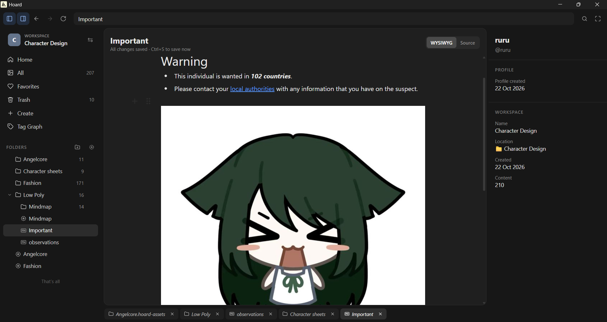

# Hoard - Reference Collection Board App for Artists & Designers

Hoard is a fast, lightweight, and open-source Tauri desktop app for collecting art & design references.

Designed for artists, character designers, game developers, and UI creators. 

Effortlessly collect, organize, tag, and arrange your references locally.

With zero telemetry, subscriptions, or cloud accounts.


## **Workspaces** 
Collections mapped to a real folder on your computer


## **Folders**
Native folders in your file system; click one to see its contents in a Pinterest-style masonry feed.


## **Canvases**
(`*.hoard-canvas`) are infinite:
  - drag/drop/paste images
  - add sticky notes, text, shapes, arrows, freehand sketches
  - edit images: crop, flip, colour adjustments (HSV)
  - PNG export - either whole canvas or selection
  - added files are saved into a folder automatically.


## **Tagging**
Manual tags, auto tags, source link, creator, notes, rating, favourite. Search along a graph to find inspiration that matches what you're looking for, semantically.


- **Markdown**
You can write your own notes within the app with markdown, notion-style. Great for art studies, jotting down plans, making todo-lists.




Privacy-First & Open-Source: Free, open-source software with no credit cards, user accounts, or tracking.

## Current Features
- [x] separate your references into profiles and workspaces
- [x] fully open-source: no credit cards, accounts, or telemetry here
- [x] view your images and videos like you would on pinterest.
- [x] bring your files into a canvas, where you can arrange, draw and brainstorm your designs.
- [x] automatic image tagging using open-source locally run AI models.
- [x] use semantic proximity to find content that is related to a tag.
- [x] export your canvas as a png.
- [x] write your own notes, notion-style.


note: You can add your own models from HuggingFace, but this is very experimental. Use at your own risk.


## Roadmap
- [ ] overlay canvases over other apps
- [ ] better keyboard shortcuts for canvas
- [ ] embed youtube, twitter, etc
- [ ] plugin support
- [ ] Slot in LLM access for tagging files
- [ ] MCP server for your AI bots


# Download It
[Get the latest version here](https://github.com/Isuru2701/Hoard/releases)


# Issues
If you ever find bugs, or features you'd like, just raise an Issue, and I'll look into it. 
This is a hobby project, and if you'd like to contribute to it, just make a pull request.

---
# Development
```
npm install
npm run dev
```

For a standalone static build: `npm run build` and host the `dist/` folder.

## Windows desktop app

The desktop build uses Tauri 2. It keeps the React interface but uses native Rust
filesystem commands for linked workspaces, so selected folders are available
through the normal Windows filesystem instead of the browser File System Access API.

Install the Windows prerequisites once:

1. WebView2 (normally already installed on Windows 10/11).
2. Rust using the MSVC toolchain.
3. Visual Studio Build Tools with **Desktop development with C++**, including
   the Windows SDK.

Then run the development app:

```
npm install
npm run desktop:dev
```

Create the Windows installers:

```
npm run desktop:build
```

The generated `.msi` and NSIS `.exe` installer are placed under
`src-tauri/target/release/bundle/`.

GitHub Actions builds the same Windows artifacts automatically on pushes and
pull requests. You can also run it manually from the Actions tab using
**Build Windows desktop app**. The workflow uploads the installers and the
portable executable as downloadable workflow artifacts.

Desktop workspaces store their selected absolute folder path in the workspace
registry. Images, videos, canvases, and `.hoard` metadata remain in that folder.

## Local model tagging

Image tagging is explicit and local. Open **Tag Graph** to download the included
model once, choose the number of generated tags (5 by default), and auto-tag all
images in the workspace. The same model can tag one selected image from the
folder feed or canvas through the right sidebar. Generated suggestions are
stored separately from manual tags.

The included models are [Xenova/clip-vit-base-patch32](https://huggingface.co/Xenova/clip-vit-base-patch32),
approximately 354 MB in its quantized Transformers.js variant, and
[SmilingWolf/wd-vit-tagger-v3](https://huggingface.co/SmilingWolf/wd-vit-tagger-v3),
approximately 379 MB. 

CLIP is a zero-shot image classifier prompted with
expressive art-reference concepts such as clothing styles (for example, casual wear,
gothic fashion, and streetwear), color treatments (such as monochrome), mood,
aesthetic, medium, and motifs. These are curated candidate labels rather than tags
predicted from an open-ended vocabulary, so suggestions remain limited to the
listed concepts. The vocabulary can be edited in Tag Graph for CLIP models, allowing
you to add or remove the concepts most useful to your collection.

WD ViT Tagger is a Danbooru-trained illustration tagger with its own ONNX
inference path and general-tag vocabulary. Custom ONNX models use the labels
provided by their own model and may vary in how specific their results are.
The model selector explains these differences in plain language. All models are
downloaded on demand, cached locally, and run without uploading images.
